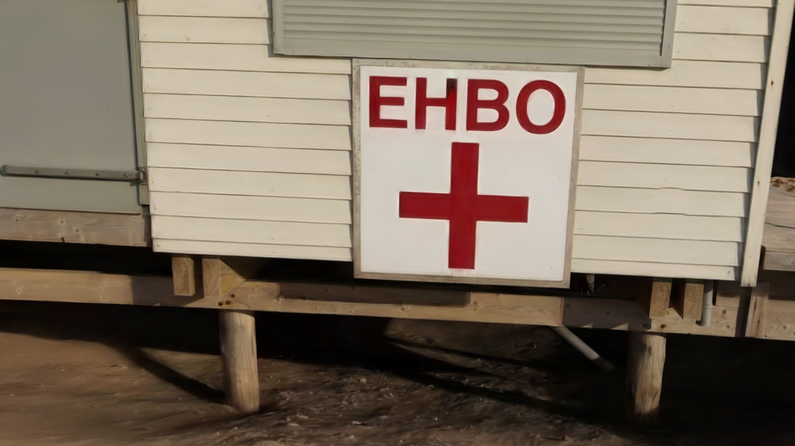
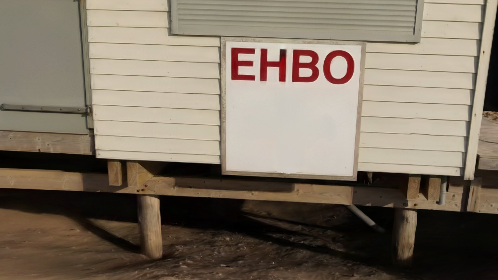

# Splat Repair

An editor for Gaussian splats with a repair brush. You paint over what should
go, and the tool rebuilds the surface underneath: geometry, colour and
view-dependent appearance.

| Scan | After Fast Fill |
|---|---|
|  |  |

I built this in eight days and filmed it:
[I built Photoshop for Gaussian Splats in 8 days](https://www.youtube.com/watch?v=qwjmxt8kfl0).

## What works and what doesn't

- **Flat and gently curved surfaces** fill in about a second. Walls, signs,
  floors, stickers and small handles are the easy cases.
- **Strong repeating relief** is hard. On the sole of a shoe the fill often
  shows and needs patching by hand with the Clone Stamp.
- This is an early release from one person. Expect rough edges, and save
  copies of your scans.

## Tools

| Tool | Key | What it does |
|---|---|---|
| View | `V` | Camera only |
| Brush | `B` | Paints a 3D selection along the stroke |
| Lasso | `L` | Freehand selection, surface only or through the object |
| Rectangle | `R` | Box selection |
| Clone Stamp | `S` | Alt+click sets the source, painting stamps it |
| Move | `G` | Transforms the selection |
| Clean up | | Finds floaters, crops with a box |

On a selection you can delete, fill or export.

In the Selection panel, **Selection display → Bright highlight** makes selected
splats yellow and boosts their displayed opacity. **X-ray markers** also draws
solid yellow squares at selected centres, including behind surfaces. These are
view-only aids: exported colour, opacity, geometry, and selection membership
are unchanged. Deleted/cropped splats are excluded. For large selections the
marker overlay samples up to 20,000 centres; the panel reports this limit.
Choose **Normal** to return to the usual blue tint.

**Clean Up → Surface haze** is an experimental CPU detector for faint splats
displaced from nearby opaque, locally flat surfaces. Choose **Current selection**
to analyse a brushed region (using the rest of the model as surface reference),
or **Whole model**, then **Select surface haze**. Higher thresholds select fewer
candidates. Results replace the selection and enable X-ray markers; inspect
several views before deleting. Undo restores the previous selection if you want
to rerun a region with a different threshold.

This does not sharpen textures or retrain the scan. It deliberately skips rough
or ambiguous neighbourhoods, and can miss blur whose splat centres lie on the
surface. Legitimate translucent detail may resemble haze. It complements the
detached-floater detector; it does not guarantee automatic noise removal.

For underside cleanup, choose **Brush → Through** in the top options bar
(**Alt+Z** toggles Surface/Through). Paint from a side view to select splat
centres inside the screen-space stroke at every depth, including behind the
model. No surface hit is required, and Depth is disabled. Shift adds and Ctrl
subtracts. Review with X-ray markers before deleting. Surface retains the
original depth-limited 3D brush. Through selection uses projected centres,
not the full translucent footprint of each splat.

### Navigation and orientation

Choose **View → Mouse Like Metashape** for left-drag to pan (in the Orbit
tool), middle-drag to orbit, and right-drag or the wheel to zoom. Editing
tools retain left-drag for painting and selection. Metashape is the default
for new preferences; existing Blender/SuperSplat preferences are retained.

DJI Terra PLY exports with an unrotated `LOCAL_ENU_CS` `geo_desc.json`
beside the file or up to two folders above it open with **+Z up**. This
changes the camera frame, not the stored coordinates. Unknown or rotated
coordinate systems retain the existing default; orientation is not guessed
from scene geometry. Keep the Terra sidecar with its Block/LOD folders.

Press **U** (or click the Up button) to choose and remember an axis for a
file. **Shift+U** (or Shift-click) clears that override and reapplies automatic
orientation. The Up button tooltip identifies the detected orientation.

- **Fast Fill** is geometric. It fits the surface around the hole and copies
  whole splats from nearby, so scale, rotation and spherical harmonics stay
  consistent. It runs on the CPU in about 0.3 to 1.5 s on a scan with 550,000
  splats.
- **Deep Fill** renders a view, lets an inpainting model (LaMa) fill the
  picture and lifts the result back into splats. It needs an NVIDIA GPU and
  takes around 20 s on an RTX 4090.
- **Fill from Photoshop** (optional) sends the rendered view to your own
  Adobe Photoshop installation and uses its Content-Aware or Generative Fill.

Splat Repair reads and writes `.ply`, `.splat` and `.spz`. PLY is the working
format and round-trips bit-exact.

## Requirements

- Windows 10 or 11. The code is not tested on macOS or Linux.
- [Node.js](https://nodejs.org) 22 or newer.
- Python 3.10 to 3.13.
- For Deep Fill: a supported NVIDIA GPU and Visual Studio 2019/2022 C++ build
  tools with a Windows SDK. Setup installs a small CUDA compiler inside the
  engine environment; it does not replace the graphics driver. About 3.2 GB
  of downloads, including LaMa and the compiler.

## Install

1. Install [Git](https://git-scm.com), [Node.js](https://nodejs.org) and
   [Python](https://www.python.org) if you do not have them.
2. Get the code and run the installer:

```bash
git clone https://github.com/NicolasDrum/splat-repair.git
```

```bash
cd splat-repair
```

```bash
install.cmd
```

3. Start the app with `app\start.cmd`.

Everything is installed inside the `splat-repair` folder. To remove Splat
Repair, delete the folder and any shortcuts or taskbar pins you created.

For Deep Fill (PyTorch, gsplat and LaMa), run the installer with `deep`. You
can do that at any time:

```bash
install.cmd deep
```

During the Deep Fill setup pip prints dependency conflicts for
`simple-lama-inpainting`. That is expected; the setup ends with "Deep Fill is
ready" when everything works.

Setup verifies an actual GPU render and LaMa fill before reporting success.
The taskbar shortcut uses the same environment. Restart the app after setup,
then select an area and choose **Deep Fill → LaMa, wide view → Repair**.
See [Deep Fill setup and verification](docs/deep-fill-setup.md) for installation
locations, supported versions and troubleshooting.

Without Git you can also download the ZIP from the green Code button on
GitHub, unpack it and run `install.cmd` in the unpacked folder.

`app\create-shortcut.ps1` builds the app and creates branded **Splat Repair**
shortcuts on the desktop and in the Start menu:

```bash
powershell -ExecutionPolicy Bypass -File app\create-shortcut.ps1
```

Right-click **Splat Repair** in Start (under **More**, if shown), or its running
taskbar icon, and choose **Pin to taskbar**. The pin can launch the app again
after you close it. If you have an older generic Electron or terminal pin,
unpin it first and pin the new shortcut.

Shortcuts launch the latest built app directly. After changing source code,
run `app\start.cmd` once to rebuild as needed, or run `npm run build` in `app`.
If you move the repository, rerun the shortcut script and recreate the taskbar
pin. See [Windows launcher details](docs/windows-launcher.md).

## Update

```bash
update.cmd
```

This pulls the newest version and rebuilds the app. Add `deep` if you use
Deep Fill and the release notes mention changed requirements.

<details>
<summary>Manual install</summary>

```bash
cd core
py -3.11 -m venv .venv
.venv\Scripts\python -m pip install -r requirements.txt
```

```bash
cd app
npm install
npm run build
npx electron .
```

```bash
core\.venv\Scripts\python.exe core\setup_deep.py
```

</details>

## Develop

```bash
cd app
npm run dev
```

Run the engine tests (each file is a plain script):

```bash
cd core
for %t in (tests\test_*.py) do .venv\Scripts\python %t
```

## How it is built

```
app/      Electron + PlayCanvas (WebGPU): the interface
  electron/      main process, preload, engine process handling
  src/engine/    viewer, selection, volumes, document
  src/ui/        menus, history, view cube
core/     Python engine: formats, repair, document, server
```

- The interface and the engine talk over the child process pipe. There is no
  HTTP server and no open port.
- Both sides read the same file, so splat index 12345 means the same splat in
  the viewer and in the engine. An edit crosses the pipe as a few thousand
  numbers.
- Indices are stable. The loaded file keeps its range, new splats are
  appended, and edits flip `alive` flags, which makes undo cheap.

## Licence

Apache License 2.0, see [LICENSE](LICENSE) and [NOTICE](NOTICE). Third-party
components and their licences are listed in
[THIRD_PARTY_LICENSES.md](THIRD_PARTY_LICENSES.md).

Deep Fill downloads the LaMa model on first use. Its authors publish code and
weights under Apache 2.0; the model was trained on the Places2 dataset, which
has its own terms. Check them if you use Deep Fill commercially.

Adobe and Photoshop are trademarks of Adobe Inc. Splat Repair is an
independent project and is not affiliated with or endorsed by Adobe.

## Contributing

Issues and pull requests are welcome. See [CONTRIBUTING.md](CONTRIBUTING.md).

Made by [Nicolas Drum](https://nicolasdrum.com).
